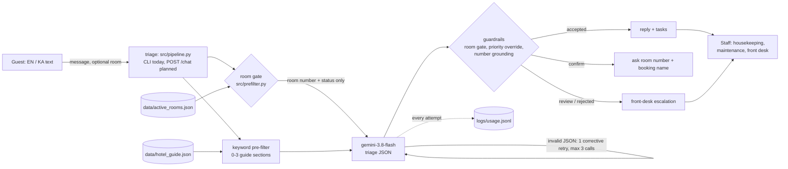

# Design Review · StumarOS (სტუმაროს) · team-stumaros

Members: Luka Dumbadze · [@Luka-Dumbadze](https://github.com/Luka-Dumbadze) · Urju · [@UrjuHub](https://github.com/UrjuHub) · Mariami Tskhomelidze · [@ZONDROK](https://github.com/ZONDROK) · roles: [`docs/TEAM-REPO.md`](TEAM-REPO.md) §1 · Repo: https://github.com/Luka-Dumbadze/team-stumaros · Graded commit: tag `design-review` (2026-10-20); this revision follows instructor feedback.

## 1 · Problem, users, success criteria

**Problem.** At a 15–60 room boutique hotel in Georgia, one receptionist on a shared phone reads every guest WhatsApp message during the check-in rush. They answer the same policy questions repeatedly and retype service requests into housekeeping and maintenance tasks. A request from a room that already checked out, or a confident wrong answer ("the pool is open late"), creates real staff work.

**Users.** Front-desk staff, who need validated tasks (room, department, priority) instead of chat logs. Guests writing in English or Georgian. Full spec: [`docs/spec.md`](spec.md).

| # | Success criterion (from `docs/spec.md`) | Measured by | Today |
|---|---|---|---|
| S1 | Answers come only from `hotel_guide.json`. An unanswerable question gets "not available" + a front-desk offer. Zero forbidden claims. | golden set [`evals/golden.yaml`](../evals/golden.yaml) (`must_mention`, `must_not_mention`, `expect: refused`) | offline 4/5 (0.80); **live not yet measured** (provider outage, §4) |
| S2 | No task for a missing, unknown, checked-out or expired room | room-gate tests in `tests/test_feature.py`; golden g2, g3 | passing; live in HW1, the gate dropped a task the model proposed |
| S3 | At most 3 model calls per request | `call_with_budget` + `test_transient_errors_capped_at_three_calls`; `request_id` in `logs/usage.jsonl` | passing; max 3 per request in the log |
| S4 | p95 end-to-end latency ≤ 3,000 ms | `src/bench.py` (later: harness on `POST /chat`) | **FAIL**: p95 8.36 s, p50 5.35 s (HW1 live, n = 9) |

The spec's 24-scenario `POST /chat` harness is the Week 5+ target; until then S1–S3 use the 5-question set.

## 2 · Architecture and data flow

| Model call | Model id | Input | Output | Validated by |
|---|---|---|---|---|
| triage | `gemini-3.8-flash` (Google AI Studio); `google/gemini-3.8-flash` via OpenRouter as fallback | system prompt + ≤ 3 guide sections + `{room, status}` + message (≤ 1,000 chars); refused before the call above 1,200 tokens | `{intent, reply, tasks[], cited_sections, needs_clarification}` | `parse_model_output` (`src/schemas.py`), then `apply_guardrails` (`src/pipeline.py`) |
| corrective retry | same | the previous output + the schema error | same | same; at most 1, inside the 3-call cap |

**Room gate before the model.** Code validates the room first. The model sees only its number and status, never a guest name. Proposed tasks are dropped unless the status is `valid`. **Retrieval (the Lab 4 path)** is a keyword pre-filter over 9 guide sections, not embeddings ([decision 0002](decisions/0002-georgian-word-start-matching.md); the arithmetic is in §5). A question with no matching section takes the refusal route. **The Lab 3 feature is not multimodal:** v1 is text-only ([decision 0004](decisions/0004-text-only-v1.md), proposed). The Week 3 pattern we apply is the routing in [`docs/confidence-policy.md`](confidence-policy.md). **Human in the loop:** staff act on every task and escalation; a staff queue comes with `POST /chat`.

## 3 · Risks and safety threats

@Luka-Dumbadze owns the pipeline, evaluation and LLM risks; @UrjuHub owns data, privacy and staff-process risks.

| Risk | What a user would see | Mitigation (link, or plan and week) | Owner |
|---|---|---|---|
| Invented amenity, no number in it | "Yes, we offer a free airport shuttle" | prompt rule only; code cannot catch it ([confidence policy](confidence-policy.md)). Golden g5 tracks it; claim-vs-section check by the Week 11 Audit. | @Luka-Dumbadze |
| Invented time or price | "the pool is open until 24:00" | code replaces the reply with the front-desk escalation (`test_invented_time_replaces_reply`); the Lab 4 refusal path handles questions with no matching section | @Luka-Dumbadze |
| Task for a room the guest does not occupy (prank, checked out, typo) | staff sent to the wrong room | room gate in code ([decision 0001](decisions/0001-room-gate-in-code.md)); conflicting rooms are never trusted; `confirm` / `review` routes | @Luka-Dumbadze |
| Priority over-escalation | "bottles of water" or "7 o'clock" filed as `urgent` | known bug ([decision 0001](decisions/0001-room-gate-in-code.md)); word boundaries + regression tests, Week 5 | @Luka-Dumbadze |
| Provider outage or quota | fallback reply after up to 3 calls; all 18 live calls failed on 2026-11-24 | 3-call cap, no task without a model answer; paid or OpenRouter key before the Week 11 live gate | @Luka-Dumbadze |
| Personal data | guest names or ID images exposed | names never enter prompts (test); `data/` is mock; no faces or ID documents ([decision 0004](decisions/0004-text-only-v1.md)); no emails in docs (old commits keep one; history not rewritten) | @UrjuHub |
| Wrong or stale policy in the guide | a correct-looking answer from outdated rules | `hotel_guide.json` is human-curated and read-only for agents (`AGENTS.md`); content review with the hotel before Demo Day | @UrjuHub |
| Fallback promises a follow-up nobody sends | "flagged for the front desk", then silence | staff notification or reworded fallback when `POST /chat` lands, Week 6 ([confidence policy](confidence-policy.md) §4) | @UrjuHub |

## 4 · Evaluation plan

- **Golden set:** [`evals/golden.yaml`](../evals/golden.yaml), 5 questions in the Week 4 mix:
  - g1 reasoning: Georgian pillows + breakfast, room 204
  - g2 factual: pool at 23:30 from checked-out room 305
  - g3 factual: broken AC, no room
  - g4 edge: typos
  - g5 refusal: free airport shuttle

  Threshold 0.70. Index: [`evals/results/`](../evals/results/README.md).
- **Last live run:** 2026-11-24, [`golden-20261124-162717-live.md`](../evals/results/golden-20261124-162717-live.md). It scored 0/5 because the **provider failed** (HTTP 500/503 "high demand", 429s on all 15 calls). That says nothing about the model. Two g5-only retries ([16:56](../evals/results/2026-11-24-1656-live-partial.md)) failed the same way (HTTP 500). **Current offline run:** [`2026-11-24-1644-offline.json`](../evals/results/2026-11-24-1644-offline.json), **4/5 (0.80)**. Earlier evidence: the 3 HW1 cases passed live on 2026-10-15 ([`hw1/Luka-Dumbadze/golden.md`](../hw1/Luka-Dumbadze/golden.md)).
- **What failed and why:**
  - **g4** fails offline: "chek out" matches no keyword, so no section is sent and the reply refuses instead of answering 11:00. Safe but unhelpful; the fix is fuzzy matching, with a new decision record.
  - **g5 is unverified live.** Its offline pass means nothing, because the mock cannot hallucinate. It is the first question to run on a fresh quota.
- **By Week 11:** 10 questions, **3 factual, 2 reasoning, 2 edge, 2 refusal, 1 format**. We add:
  - 1 factual: parking price
  - 1 reasoning: late check-out time + fee
  - 1 edge: payload and message name different rooms
  - 1 refusal: spa booking
  - 1 format: every task field from the allowed enums, reply in the guest's language

  The runner exits 1 below 0.70, and CI ([`.github/workflows/ci.yml`](../.github/workflows/ci.yml), today `pytest -q tests`) runs it as a required check. **The gate blocks** any merge that drops the pass rate below 0.70. A live run needs a key as a repository secret; 10 questions × up to 3 calls exceed the free tier's ~20 requests/day.

## 5 · Token budget

| Feature | Model | Tokens in / out (median) | Cost per request | Latency (median) | Source |
|---|---|---|---|---|---|
| triage, live | gemini-3.8-flash | 463 / 89 | $0.00068 | 5.35 s (p95 8.36 s) | the 9 successful live answers from 2026-10-15, with API `usage` ([`hw1/Luka-Dumbadze/golden.md`](../hw1/Luka-Dumbadze/golden.md)) |
| `logs/usage.jsonl` | n/a | none yet | n/a | n/a | [`2026-11-24-1647-usage.json`](../evals/results/2026-11-24-1647-usage.json): 18 live attempts, 0 answered |

Prices are $0.75 / $3.75 per million tokens (in / out, promotional; verify before shipping).

**Honest gap.** HW1 did not write the usage log, so these medians come from 9 real API responses recorded in `golden.md` (the brief asks for 10). Every attempt is now logged to `logs/usage.jsonl`; `python evals/usage_summary.py --save` replaces this row after the next live run.

**Monthly cost** at 200 requests/day: 200 × 30 × $0.00068 ≈ **$4.09**.

**Georgian.** HW1 measured **463 input tokens for the Georgian message vs 466 for an English one**: the penalty is not in the input, because the English system prompt dominates it. It is in the **output: 145 vs 89 tokens, about 1.6x**. That makes ≈ $5.35/month for all-Georgian traffic against ≈ $4.10 for English. (These are two different messages, so treat it as indicative.)

**RAG or long context.** Sending the whole guide plus the room list on every call means about 2,560 input tokens. That is $0.00225/request and ≈ $13.50/month (3.3x), and it would also put every guest's name in every prompt. The pre-filter wins on both cost and privacy.

## 6 · Team, roles and decisions

- **Team contract:** [`TEAM-CONTRACT.md`](../TEAM-CONTRACT.md) at the repo root. Proposed roles: Luka is Repo + Eval keeper, Urju is Spec + Data & content keeper, Mariami's is to agree. **Signed by Luka; Urju and Mariami to sign (overdue since Week 3).** Roles: [`docs/TEAM-REPO.md`](TEAM-REPO.md) §1.
- **Decision records** ([`docs/decisions/`](decisions/)):
  - [0001 room gate in code](decisions/0001-room-gate-in-code.md)
  - [0002 Georgian word-start matching](decisions/0002-georgian-word-start-matching.md)
  - [0003 one OpenAI-SDK client, thinking off](decisions/0003-openai-endpoint-portability.md)
  - [0004 text-only v1 (proposed)](decisions/0004-text-only-v1.md)
- **AI use:** Claude Code drafted this revision; see [`docs/delegation-log.md`](delegation-log.md).
- **Next:**
  - Week 5: `POST /chat` with session state, the over-escalation fix, and a live golden run with a working key.
  - Week 6: staff notification for escalations.

  Drivers come from the slice rota in `docs/TEAM-REPO.md` §1.
